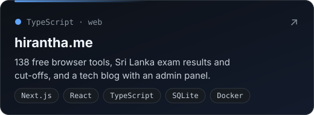
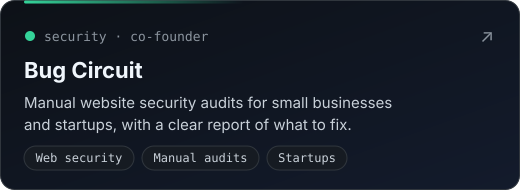
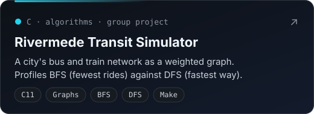
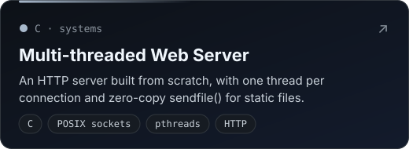
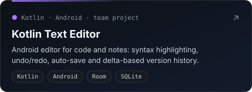
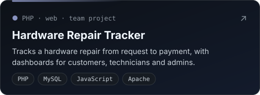
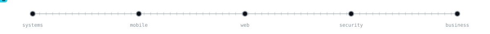

<p align="center">
  
</p>

<p align="center">
  <a href="https://hirantha.me"></a>
  <a href="https://www.linkedin.com/in/hirantha-sandaruwan-lakshan-961b72314/"></a>
  <a href="https://bugcircuit.com"></a>
  <a href="mailto:hirantha2004@gmail.com"></a>
</p>

### 👋 Hi, I'm Hirantha

I study Information Systems at the **University of Colombo School of Computing**, where computer science meets business. Alongside my degree I work as an **Associate at EFL Global** with clients in different countries, and I co-founded **[Bug Circuit](https://bugcircuit.com)**, which checks websites for security holes by hand.

I like building things end to end: systems code in C, Android apps in Kotlin, and free web tools on **[hirantha.me](https://hirantha.me)**.

```c
struct Developer hirantha = {
    .based_in  = "Colombo, Sri Lanka",
    .studying  = "B.Sc. Information Systems @ UCSC",
    .working   = "Associate @ EFL Global",
    .cofounded = "Bug Circuit: manual website security audits",
    .building  = "hirantha.me: 138 free browser tools",
    .languages = { "C", "Python", "Kotlin", "TypeScript", "PHP", "SQL" },
};
```

### 🚀 Featured work

<p align="center">
  <a href="https://hirantha.me"></a>
  <a href="https://bugcircuit.com"></a>
</p>
<p align="center">
  <a href="https://github.com/HiranthaSandaruwan/rivermede_transit_simulator"></a>
  <a href="https://github.com/HiranthaSandaruwan/Web-Sever"></a>
</p>
<p align="center">
  <a href="https://github.com/HiranthaSandaruwan/Modern-Mobile-Text-Editor-with-Incremental-Version-Control"></a>
  <a href="https://github.com/HiranthaSandaruwan/Hardware-Request-Tracker"></a>
</p>

### 🧰 Tech stack

<p align="center">
  
</p>
<p align="center"><sub>Also: POSIX sockets and pthreads · Apache · CargoWise for logistics</sub></p>

### 🏆 Highlights

- **Semi-Finalist**, TECH-TRIATHLON 2026 by Rootcode
- **CargoWise Certified Professional**, WiseTech Global
- **CS50P: Introduction to Programming with Python**, HarvardX
- **Behavioral Finance**, Duke University on Coursera

<p align="center">
  
</p>
<p align="center"><sub>Thanks for stopping by. Next stop: <a href="https://hirantha.me">hirantha.me</a></sub></p>
